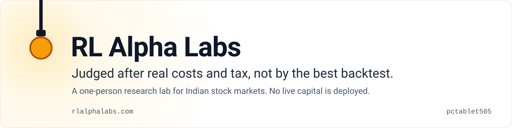
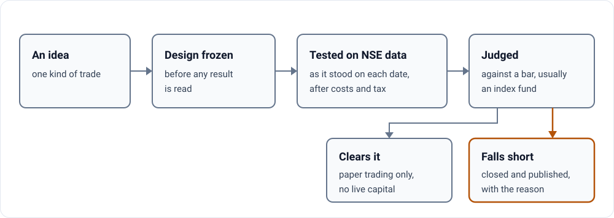

<p>
<a href="https://rlalphalabs.com/">
<picture>
  <source media="(prefers-color-scheme: dark)" srcset="assets/hero-dark.svg">
  
</picture>
</a>
</p>

**Judged after real costs and tax, not by the best backtest.** RL Alpha Labs is a one-person research lab for
Indian stock markets. It tests each trading idea against a bar, usually an index fund, on NSE data as it stood on
each date, and publishes the ideas that fall short, with the reason.

**[Start with the eight backtest traps that fooled us →](https://rlalphalabs.com/notes/backtest-traps/)**

  

## What you get

The lab's findings, written as short notes:

| Note | What it answers |
| --- | --- |
| [Backtest traps that fooled us](https://rlalphalabs.com/notes/backtest-traps/) | Eight traps that fooled us or nearly did, and how we check for each one now |
| [Ideas we closed](https://rlalphalabs.com/notes/ideas-we-closed/) | Which kinds of idea fell short after costs and tax, and why |
| [What trading really costs on NSE](https://rlalphalabs.com/notes/trading-costs/) | The fees, spreads and taxes a delivery trade pays, in basis points |
| [How one person runs a lab with AI agents](https://rlalphalabs.com/notes/how-we-run-ai-agents/) | The rules, guards and reviews behind every number |

One of the eight traps: a test decided on the closing price and then filled at that same close, which no live
order can do.

## Is it for you?

For anyone who builds or judges trading backtests, above all on Indian markets, and for engineers curious how one
person runs a research lab with AI agents.

What it is not:

- **Not a trading product.** No signals and no managed money.
- **Not live.** Simulation and paper trading only. No live capital is deployed, and no AI model places trades.
- **Not advice.** RL Alpha Labs is not registered with SEBI as an investment adviser or research analyst; nothing
  here is investment advice.
- **Not the trading code.** That stays private. This repository is the public website.

## Quick start

This repository is the static site at [rlalphalabs.com](https://rlalphalabs.com/), served by GitHub Pages from
`main`. To preview a change:

```bash
git clone https://github.com/pctablet505/RLAlphaLabs
cd RLAlphaLabs
python3 -m http.server 8000      # then open http://localhost:8000
```

## How it works

<p>
<picture>
  <source media="(prefers-color-scheme: dark)" srcset="assets/diagram-dark.svg">
  
</picture>
</p>

Stock lists are built as they stood on each date, so companies that later failed stay in the test. The stages are
in [Methodology](https://rlalphalabs.com/research/methodology.html); the closed ideas and their reasons
are on [Ideas we closed](https://rlalphalabs.com/notes/ideas-we-closed/).

## Go deeper

<details>
<summary><b>What is in this repository</b></summary>

| Path | What it holds |
| --- | --- |
| `index.html` | the home page, with the cost calculator |
| `research/` | problem statement, methodology, open problems, literature review |
| `experiments/` | experiment write-ups |
| `notes/` | the four notes above |
| `tools/` | the open-source tools the lab runs on |
| `about/`, `blog/`, `join/`, `traction/`, `privacy/` | the rest of the site |
| `css/`, `js/`, `data/` | style, scripts and the data the pages read |
| `sitemap.xml`, `robots.txt`, `llms.txt`, `feed.xml` | for search engines, feed readers and AI assistants |

</details>

| To | Read |
| --- | --- |
| See the method | [Problem statement](https://rlalphalabs.com/research/problem-statement.html) · [Methodology](https://rlalphalabs.com/research/methodology.html) · [Open problems](https://rlalphalabs.com/research/open-problems.html) |
| See the results | [Experiments](https://rlalphalabs.com/experiments/) · [Ideas we closed](https://rlalphalabs.com/notes/ideas-we-closed/) |
| Meet the lab | [About](https://rlalphalabs.com/about/) · [Open-source tools](https://rlalphalabs.com/tools/) · [Join](https://rlalphalabs.com/join/) |

---

<picture><source media="(prefers-color-scheme: dark)" srcset="assets/mark-dark.svg"></picture>
<sub>**Real numbers, failures left in.** RL Alpha Labs is built by [pctablet505](https://github.com/pctablet505). Past simulation results do not guarantee future live performance.</sub>
